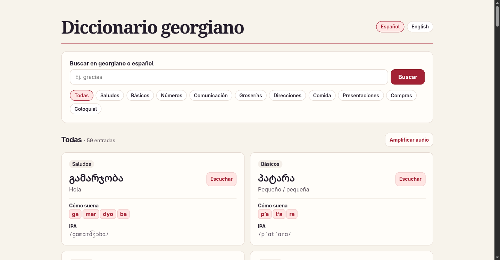

# Georgian–Spanish IPA Dictionary

A Georgian phrasebook for Latin American Spanish speakers. Each entry shows
the Georgian text, its Spanish meaning, an IPA transcription, and an
approximate pronunciation guide broken into syllables. The website interface
is available in English and Spanish. Each mode shows meanings and an
approximate pronunciation guide in the selected language.

## Live dictionary

[Open the Georgian dictionary](https://georgian-dictionary.esauflores.com/)



## Install and run

Install [mise](https://mise.jdx.dev/installing-mise.html) on Windows, macOS, or
Linux. From the root of the repository, run:

```sh
mise install uv
mise exec -- uv sync --locked
mise dev
```

Open [the dictionary](http://127.0.0.1:8000/) in your browser. The development
server reloads when Python files in `src/` change. If port 8000 is in use,
run `mise dev --port 8020` and open port 8020 instead.

`mise.toml` pins uv, `.python-version` selects Python 3.12, and `uv.lock` pins
the dependencies. If you already have uv, you can also start the app with
`uv sync --locked` followed by `uv run --locked python src/main.py`.

## Use the dictionary

Search by Georgian text or by meaning in the selected language, or select
a category such as Numbers or Greetings. Search accepts partial matches, ignores case, and lets
you omit Spanish vowel accents. The English and Spanish buttons change the
interface labels and preserve the current search and category.

Use [FastAPI's interactive docs](http://127.0.0.1:8000/docs) to try the API:

- `GET /entries` lists the 36 starter entries. Try `q=cuanto`, `q=cafe`, or
  `q=მადლობა`. You can combine `q` with a tag such as `numbers`, `slang`,
  or `curse`.
- `GET /tags` lists all available tags.
- `POST /entries` adds a phrase with optional tags. The app saves changes in
  `entries.json` in the repository root when run from there.

## Project structure

- `src/main.py` defines the FastAPI routes.
- `src/dictionary/` contains `Entry`, the phrase dataclass, `Dictionary`,
  which uses a generator to search entries, and `JsonStore`, which reads and
  writes JSON using `pathlib`.
- `data/starter.json` contains the starter entries.
- `tests/` covers the dictionary, API, and browser-facing HTML.

## Pronunciation

Hyphens separate syllables in the Spanish guide. `sh` represents /ʃ/, `dy`
approximates /d͡ʒ/, `j` approximates /x/, `gh` represents /ɣ/, and an apostrophe
marks an ejective consonant. Pronounce `v` with your lower lip against your
upper teeth. In the English guide, `ah`, `eh`, `ee`, `oh`, and `oo`
represent the five Georgian vowels. `kh` is the sound at the end of Scottish
*loch*. Use the IPA or listen to the Georgian audio for sounds the guides
can only approximate.

[Peace Corps Georgian lessons](https://files.peacecorps.gov/multimedia/audio/languagelessons/georgia/GE_Georgian_Language_Lessons.pdf) ·
[Standard Georgian, by Shosted and Chikovani](https://linguistics.berkeley.edu/phonlab/documents/2006/shosted_chikovani_11-23.pdf)

## Generate Georgian audio

```sh
mise generate-audio
```

The first run installs Piper and downloads its Georgian voice
(`ka_GE-natia-medium`) to `.piper/`. Piper generates WAV files locally
in `src/static/audio/`, with one clip per distinct Georgian entry in
`data/starter.json`. Later runs reuse the model and skip existing clips.
The model and generated audio stay in your local checkout. Generation
requires no API key. Cards with a generated clip show an **Escuchar** or
**Listen** button that plays the saved audio in the browser.

[Piper](https://github.com/OHF-Voice/piper1-gpl) ·
[Georgian Natia voice](https://huggingface.co/rhasspy/piper-voices/blob/main/ka/ka_GE/natia/medium/MODEL_CARD)

## Development commands

| Command | What it does |
| --- | --- |
| `mise dev` | Starts the FastAPI server with reload |
| `mise test` | Runs pytest |
| `mise lint` | Checks Ruff lint and formatting |
| `mise format` | Formats Python files with Ruff |
| `mise generate-audio` | Generates missing Georgian WAV clips with Piper |

## Browser tests

Install Chromium once, then run the optional Playwright suite:

```sh
uv run --locked --group test-browser playwright install chromium
mise run test-browser
```

The browser tests in `tests/browser/` start a temporary local FastAPI server and use generated
silent WAV clips. They cover language and category navigation, search, mobile
layout, and audio playback. `mise run test` runs the regular pytest suite.
GitHub Actions runs both suites and Ruff on pull requests and pushes to main.

## Railway deployment

[.railway/railway.ts](.railway/railway.ts) defines both dictionary services in
the Railway `demos` project's `production` environment. Railway deploys code
from each service's GitHub branch. To change the service configuration, link
the Railway CLI to that environment, install the configuration SDK, and
preview the changes from the repository root.

```sh
(cd .railway && bun install --frozen-lockfile)
railway config plan
```

Run `railway config apply` after reviewing the plan.
